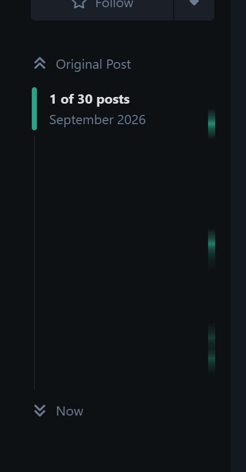

# Ridge

A long **Flarum 2** thread has a shape. A few posts get quoted, reacted to and
marked far more than the rest — and nothing in the forum shows you where they
are. You scroll, and hope.

Ridge reads the signals the forum already holds and draws them as a strip of
shading down the post scrubber, so a 300-post thread tells you where its high
ground is before you get there.



Three bands, three places the thread actually turned: the budget everyone
quoted, the quote that settled the venue, and the post that booked it.

## What it reads

Nothing is curated, nobody votes, and no new content type exists.

| Signal | Weight | Why |
|---|---|---|
| Being quoted | **3** | The strongest ordinary signal a forum makes — it costs the quoter something and says *these words* mattered |
| Being marked | **2** | Nobody highlights a passage for someone else's benefit ([Marginalia](https://github.com/ernestdefoe/marginalia), public marks only) |
| Reactions | **1** | Cheap by design, so worth the least — `flarum/likes` and `fof/reactions` both count |
| Accepted answer | *floor* | Not scored against the rest: given a guaranteed peak, because a scrubber that buries the resolution of a 200-post thread has failed |

Every signal is optional. Ridge checks which tables exist and counts what it
finds, so it works on a forum with none of those extensions installed — there
is simply less to draw.

## The year rail

A forum with ten years of history has the same problem one thread up: nobody
scrolls a decade. Switch on **Year rail on the discussion list** and the list
gets a slim rail beside it, every year it holds, newest first, each with its
number of discussions and a bar shaded by how much was said that year.

- **Click a year** to see that year's discussions. The address becomes
  `/?filter[ridgeYear]=2015`, so it can be shared, the list keeps its own sort
  and infinite scroll inside the year, and a "Back to latest" chip returns you.
- **Point at a year** to preview its most active discussions.
- **On phones** the rail becomes a row of years above the list.
- It follows whatever the list shows: a tag page, a search, the following
  list. A member only ever counts or previews discussions they can see.
- Settings: which pages show it, how many years before it appears (2), and
  whether a discussion belongs to the year it **started** (default) or the year
  it was **last active**.

Filtering by an exact date range is already done well by
[GB Date Filters](https://github.com/glowingblue/flarum-ext-date-filters); the rail is for
browsing.

## Decisions worth knowing about

- **Shading, not markers.** [Threadmarks](https://discuss.flarum.org/d/39803)
  and friends put pins *on* the scrubber. A second extension adding pins to the
  same forty pixels would be a fight the reader loses, so Ridge paints the
  track instead and the two can be installed together.
- **A strip at the edge, not a wash behind the track.** Full-width shading put
  a gradient under the handle's own label, which is a legibility gamble in
  every theme its author cannot see.
- **Peaks are spread over their neighbours.** One post is a fraction of a pixel
  on a 400-post track; a band is something a reader can aim at, and "around
  here" is the honest claim anyway.
- **Short threads get nothing.** Under twelve posts (configurable) there is no
  shape worth drawing and the reader can see the whole scrubber already.

## Cost

One request per discussion per page load — four aggregate counts, grouped by
post. It is a route of its own rather than an attribute on the discussion
resource, because hanging it there would run those counts for every row of the
discussion list to draw nothing.

The year rail is one grouped query over the same query the discussion list
runs, cached per viewer (guests share one entry) and refreshed when a
discussion starts, is deleted, hidden, restored, approved or re-tagged. With
50,000 discussions that query took about 60 ms for a guest on MySQL before it
was cached; afterwards the rail costs no queries at all.

## Installation

```bash
composer require ernestdefoe/ridge
```

## Support

- **Support forum:** [Ridge on ernestdefoe.online](https://ernestdefoe.online/d/95)
- **Flarum community:** [Ridge on discuss.flarum.org](https://discuss.flarum.org/d/39849-ridge-a-long-thread-shows-its-own-high-ground-built-using-ai)
- **Bug reports:** [GitHub issues](https://github.com/ernestdefoe/ridge/issues)

## Licence

MIT
